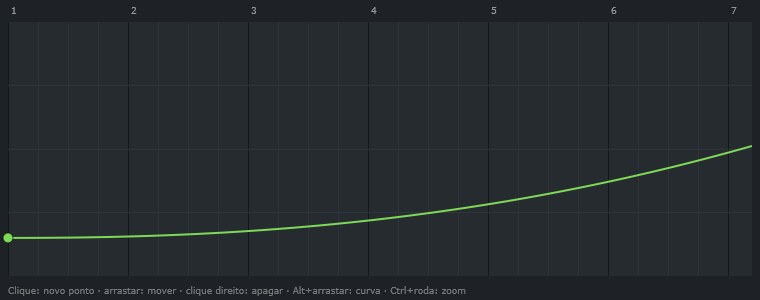

<p align="center">
  
</p>

<h1 align="center">LYNX</h1>

<p align="center"><strong>Uma DAW leve, com o fluxo de trabalho do FL Studio.</strong><br>
Channel Rack, Piano Roll, Playlist e Mixer em C++20 + JUCE 8, feita para rodar bem em qualquer PC.</p>

<p align="center">
  <a href="https://github.com/Ka1-S/LYNX/releases/latest"></a>
</p>

<p align="center">
  <a href="https://github.com/Ka1-S/LYNX/releases/latest"><strong>Download</strong></a> ·
  <a href="#recursos"><strong>Recursos</strong></a> ·
  <a href="#abre-projetos-do-fl-studio">Projetos do FL</a> ·
  <a href="#compilar">Compilar</a> ·
  <a href="docs/ESTADO.md">Estado</a> ·
  <a href="docs/ROADMAP.md">Roadmap</a>
</p>

<p align="center">
  
  
  
  
  
  <a href="LICENSE"></a>
</p>

<p align="center">
  
  <br><sub>O projeto de demonstração do próprio LYNX (<code>LYNX.exe --showcase</code>): intro, drop e final na Playlist.</sub>
</p>

---

## Destaques

<table>
<tr>
<td width="25%" valign="top">

### ⚡ Leve
Motor sem locks, canais e mixer em várias threads, canais ociosos pulados e áudios longos lidos do disco sob demanda. Um projeto de 125 trilhas exporta a mais de 10× o tempo real.

</td>
<td width="25%" valign="top">

### 🍒 Fluxo do FL
Channel Rack com step sequencer, patterns, Piano Roll, Playlist com arrangements, Mixer com inserts, envios e sidechain. Os mesmos atalhos.

</td>
<td width="25%" valign="top">

### 📂 Abre `.flp`
Importa projetos do FL Studio: canais, samples, patterns, arranjo, automação, mixer e mais de 40 plugins nativos convertidos.

</td>
<td width="25%" valign="top">

### 🔬 Clean-room
O comportamento do FL foi estudado por engenharia reversa comportamental e documentado; nenhuma linha de código da Image-Line foi copiada.

</td>
</tr>
</table>

## Recursos

<table>
<tr>
<td width="50%" valign="top">


### Channel Rack
Step sequencer com volume, pan, mute e solo por canal, swing, várias patterns (nome, cor, comprimento, clonar), cut groups, arpejador e o teclado do PC como piano.

</td>
<td width="50%" valign="top">


### Piano Roll
Snap configurável, acordes e escalas, seleção múltipla, quantizar, notas com slide e porta, faixa de velocity/pan/afinação, importar e exportar `.mid`.

</td>
</tr>
<tr>
<td width="50%" valign="top">


### Mixer
Até 127 inserts, envios com nível, 10 slots de efeito com dry/wet por trilha, EQ embutido, PDC, "smart disable" e **sidechain** (aqui o compressor do baixo ouvindo o bumbo).

</td>
<td width="50%" valign="top">


### Synth interno
3 osciladores (incluindo um oscilador de **harmônicas** com tabelas de banda limitada), filtro LP/BP/HP/BS com keytrack, FM e anel, envelopes, 4 LFOs, varredura de bumbo, mono e portamento.

</td>
</tr>
<tr>
<td width="50%" valign="top">


### EQ paramétrico de 7 bandas
Alças arrastáveis, prateleiras, cortes de 12 a 48 dB/oit, passa-banda e rejeita-faixa, com a resposta desenhada em tempo real.

</td>
<td width="50%" valign="top">


### Automação
Qualquer knob ou fader (canal, mixer, efeito, parâmetro de plugin) vira um clip com pontos e curvas; controladores MIDI ligáveis a qualquer parâmetro.

</td>
</tr>
</table>

### Tudo o que vem dentro

<table>
<tr>
<td width="33%" valign="top">

#### Instrumentos
- Synth de 3 osciladores com oscilador de harmônicas
- Sampler com zonas, fatias, stretch (WSOLA) e streaming do disco
- Bateria interna (kick, snare, hat, clap)
- Plugins VST3 e CLAP, opcionalmente em processo separado

</td>
<td width="33%" valign="top">

#### Efeitos
- EQ, EQ paramétrico de 7 bandas, compressor com sidechain, limiter
- Delay, reverb, chorus, filtro, distorção, Lo-fi
- Effector (12 algoritmos), Vocoder, correção de afinação
- Gate de volume, envelope rítmico, auto-pan, crossover Linkwitz-Riley
- Pitch shift, frequency shifter, utilitário, contêiner paralelo (Patcher)

</td>
<td width="33%" valign="top">

#### Projeto e arquivo
- Formato próprio `.lynx` (JSON) com autosave
- Importa `.flp` e `.mid`; presets `.fst` do FL
- Exporta WAV 16/24/32f, FLAC e OGG, música ou pattern, com dither
- Gravação de notas (PC e MIDI) e de áudio da entrada
- Desfazer/refazer em todas as edições

</td>
</tr>
</table>

## Abre projetos do FL Studio

O LYNX lê o formato `.flp` diretamente e converte o que tem equivalente:

- **Estrutura:** canais, samples reais (inclusive os WAV com Ogg Vorbis e WavPack da instalação do FL), patterns, notas com slide/porta, todos os arrangements, marcadores, mudanças de compasso, automação e links de controlador.
- **Mixer:** roteamento, níveis, sidechains, EQ das trilhas, efeitos nativos com os ajustes salvos (Parametric EQ 2, Limiter, Compressor, Reeverb 2, Delay 3, Maximus, Gross Beat, Effector, Love Philter, Frequency Splitter, Patcher, Pitcher, Vocoder e outros).
- **Geradores:** 3x Osc, FPC, DirectWave, FL Keys, Slicex, Fruity Slicer e Wave Traveller como sampler; Sytrus, Harmor, Harmless, GMS, Kepler, Ogun, MiniSynth, DX10, Toxic Biohazard, Sakura, Morphine, BassDrum e outros pelo synth interno, com os timbres reconstruídos a partir das curvas e tabelas de harmônicas do projeto.
- **Plugins de terceiros:** VST3/CLAP do Fruity Wrapper são trocados pelo mesmo plugin instalado, com o preset.

Ao abrir, um relatório mostra o que foi convertido, o que é aproximado e o que ficou de fora. Os pacotes FLEX são protegidos e não são abertos (o canal recebe um patch pelo nome do preset).

> [!NOTE]
> Cada lei de conversão vem de engenharia reversa **comportamental** (decompilação estudada, manual oficial e dados dos projetos), registrada em [`docs/analise/`](docs/analise). O que não foi confirmado fica marcado como aproximação em [`docs/ESTADO.md`](docs/ESTADO.md#confirmado-x-aproximado-import-do-fl).

## Para testes e automação

O `LYNX.exe` também funciona sem interface, o que permite verificar tudo sem abrir janelas:

```
LYNX.exe projeto.lynx                          abre um projeto (.lynx, .flp ou .mid)
LYNX.exe --export projeto.flp saida.flac       exporta a música (wav/flac/ogg)
LYNX.exe --render projeto.flp saida.wav 20     exporta 20 s da pattern atual (WAV 24 bits)
LYNX.exe --selftest relatorio.txt [demo.lynx]  autoteste sem placa de som
LYNX.exe --snapshot prefixo projeto.flp        desenha a interface (e as janelas) em PNG
LYNX.exe --showcase saida.lynx [pattern]       gera o projeto de demonstração usado nestas imagens
LYNX.exe --plugintest plugin.vst3 rel.txt      testa um plugin VST3 ou CLAP
LYNX.exe --sandboxtest plugin.vst3 rel.txt     testa um plugin em processo separado (inclusive travado)
LYNX.exe --scantest pasta rel.txt              busca plugins numa pasta (processos separados)
LYNX.exe --dispositivos rel.txt                lista drivers e saídas de áudio
```

## Atalhos

| Tecla | Ação |
|---|---|
| Espaço | Play / Pause |
| F5 / F6 / F7 / F8 / F9 | Playlist / Channel Rack / Piano Roll / Navegador / Mixer |
| L | Alterna Pattern / Song |
| Ctrl+Z / Ctrl+Y | Desfazer / refazer |
| Ctrl+N / Ctrl+O / Ctrl+S | Novo / Abrir / Salvar (Ctrl+Shift+S: salvar como) |
| Ctrl+R | Exportar áudio |
| `Z`..`M`, `Q`..`P` | Tocar o canal selecionado |
| Piano Roll / Playlist | Ctrl+A/C/X/V, Ctrl+B duplicar, Delete; no Piano Roll também Ctrl+Q e as setas |

## Baixar

Baixe o `.zip` da [última versão](https://github.com/Ka1-S/LYNX/releases/latest), extraia e abra o `LYNX.exe`
(Windows 10/11, 64 bits; não precisa instalar). O zip traz um projeto de demonstração (`Demo.lynx`). O executável
ainda não é assinado: na primeira execução o SmartScreen pode avisar (*Mais informações* → *Executar assim mesmo*).

## Compilar

### Windows a partir do WSL/Linux, sem Visual Studio (Zig)

```
./scripts/build-windows-zig.sh      # gera build-win/LYNX.exe
```

Precisa do Zig 0.14.1 em `~/opt/zig-x86_64-linux-0.14.1` e do JUCE 8.0.4 em `~/opt/juce-8.0.4`
(ou defina `ZIG` e `JUCE_DIR`). O JUCE 8 não suporta MinGW oficialmente; o script contorna as
diferenças (veja `cmake/mingw/` e `src/platform/MingwFixes.cpp`).

### Windows com Visual Studio

Pré-requisitos: Visual Studio 2022 Build Tools ("Desktop development with C++"), CMake ≥ 3.22 e Git.

```
cmake -B build -G "Visual Studio 17 2022" -A x64
cmake --build build --config Release
```

### Testes do núcleo (qualquer compilador C++20, sem JUCE)

```
./scripts/build-local.sh ["pasta com arquivos .flp"]
```

São mais de um milhão de verificações, incluindo a leitura dos 165 projetos `.flp` que vêm com o FL Studio 2026 quando a pasta é informada. Também gera `build-local/flpdump` (mostra o conteúdo de um `.flp`) e `build-local/renderwav`.

## Por dentro

```
src/core/     modelo, sequenciador, instrumentos, efeitos e import do .flp (C++ puro, testável sem JUCE)
src/flp/      leitor do formato .flp
src/engine/   motor de áudio (JUCE): dispositivo, grafo, samples, plugins, arquivo de projeto
src/ui/       interface: Channel Rack, Piano Roll, Playlist, Mixer, janelas
third_party/  CLAP (MIT) e decodificador WavPack (BSD)
tests/        testes do núcleo
tools/        flpdump, renderwav, comparewav, make_logo
docs/         arquitetura, estado, roadmap e a análise comportamental do FL Studio
```

- **Áudio sem bloqueio:** a interface edita uma cópia da música e publica um snapshot imutável para a thread de áudio.
- **Renderização em trechos:** cada nota cai na amostra exata; trilhas do mixer são processadas em camadas paralelas.
- **Plugins isolados:** a busca de plugins sempre roda em processos separados; opcionalmente, os próprios plugins também (um plugin que trava fica mudo e o LYNX continua).

> [!IMPORTANT]
> O LYNX está em **alfa**. Já abre, toca e exporta projetos inteiros, mas ainda não substitui uma DAW no dia a dia. O que funciona e o que falta está em [`docs/ESTADO.md`](docs/ESTADO.md); o plano, em [`docs/ROADMAP.md`](docs/ROADMAP.md); e um roteiro para testar à mão, em [`docs/TESTE_MANUAL.md`](docs/TESTE_MANUAL.md).

## Documentação

| Documento | Conteúdo |
|---|---|
| [`docs/ESTADO.md`](docs/ESTADO.md) | o que já funciona, o que é aproximado e o que falta |
| [`docs/ROADMAP.md`](docs/ROADMAP.md) | as fases do projeto |
| [`docs/ARQUITETURA.md`](docs/ARQUITETURA.md) | como o motor e a interface se organizam |
| [`docs/TESTE_MANUAL.md`](docs/TESTE_MANUAL.md) | roteiro para ouvir e mexer no que os testes automáticos não cobrem |
| [`docs/analise/`](docs/analise) | o comportamento do FL Studio levantado rodada a rodada (clean-room) |

## Créditos e aviso

O LYNX é uma implementação independente. O FL Studio foi estudado apenas para entender o comportamento e o formato de arquivo; nenhum código da Image-Line foi copiado, e nenhum conteúdo protegido (como os pacotes FLEX) é aberto.

FL Studio é marca registrada da Image-Line Software. O LYNX não tem nenhuma relação com a Image-Line. VST é marca registrada da Steinberg Media Technologies GmbH.

Feito com [JUCE](https://juce.com), [CLAP](https://github.com/free-audio/clap) e o decodificador [WavPack](https://www.wavpack.com) — as licenças de cada um estão em [`THIRD_PARTY.md`](THIRD_PARTY.md).

## Licença

O LYNX é software livre sob a [GNU Affero General Public License v3.0](LICENSE): você pode usar, estudar,
modificar e redistribuir; quem distribuir uma versão modificada (inclusive como serviço) precisa publicar o
código-fonte dela sob a mesma licença.

<p align="center">
  <a href="https://star-history.com/#Ka1-S/LYNX&Date">
    
  </a>
</p>
