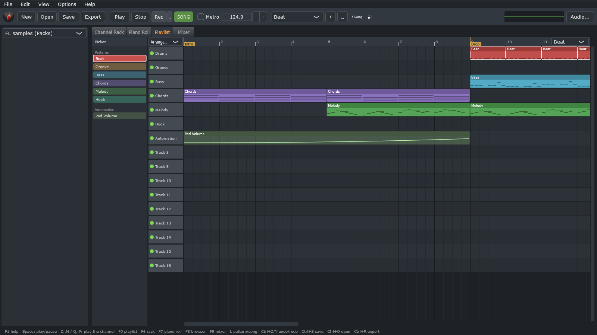
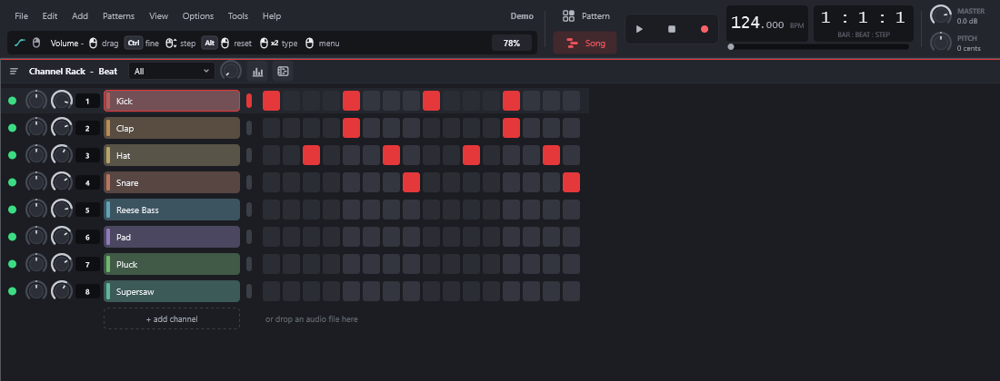
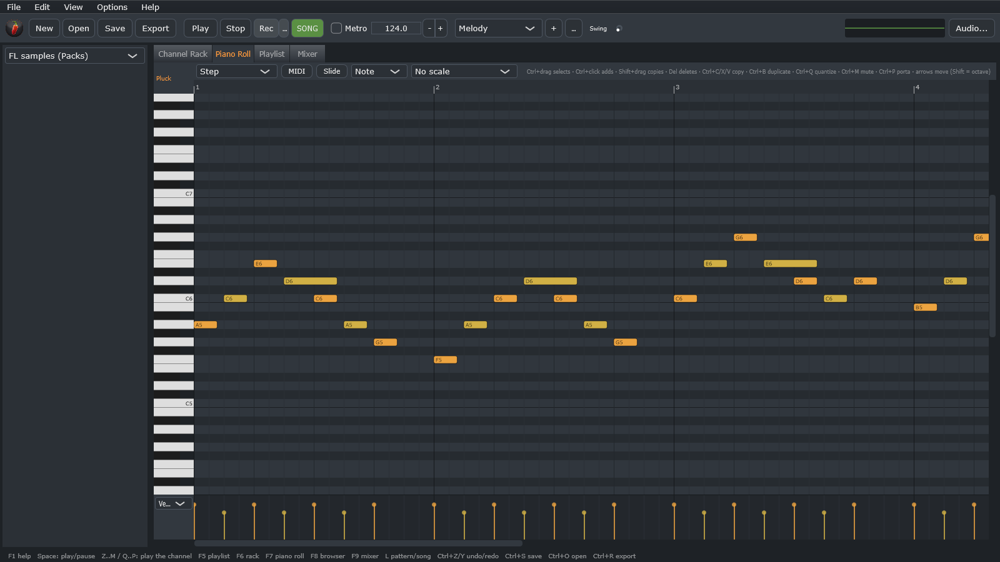
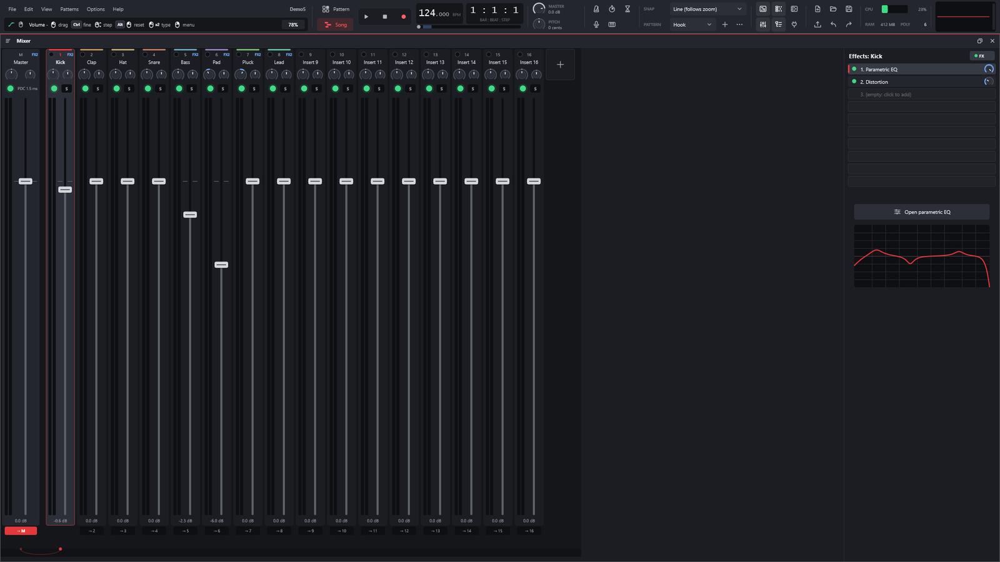
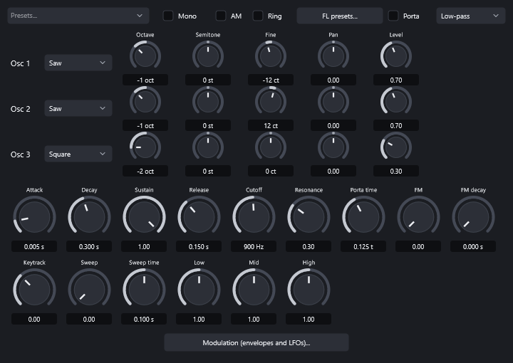
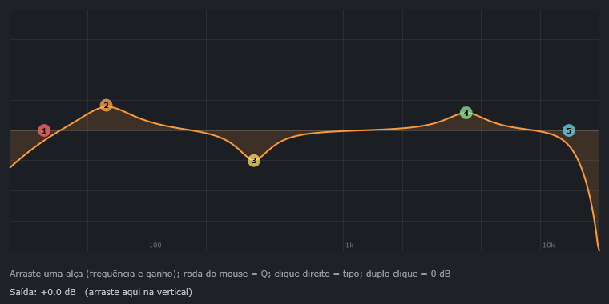
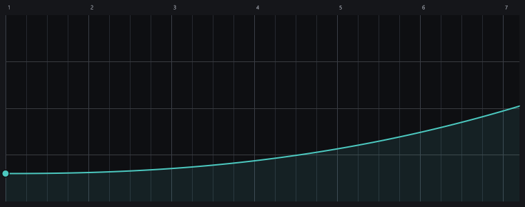

<p align="center">
  
</p>

<h1 align="center">LYNX</h1>

<p align="center"><strong>A lightweight DAW with the FL Studio workflow.</strong><br>
Channel Rack, Piano Roll, Playlist and Mixer in C++20 + JUCE 8, built to run well on any PC.</p>

<p align="center">
  <a href="https://github.com/Ka1-S/LYNX/releases/latest"></a>
</p>

<p align="center">
  <a href="https://github.com/Ka1-S/LYNX/releases/latest"><strong>Download</strong></a> ·
  <a href="#features"><strong>Features</strong></a> ·
  <a href="#opens-fl-studio-projects">FL projects</a> ·
  <a href="#building">Building</a> ·
  <a href="docs/STATUS.md">Status</a> ·
  <a href="docs/ROADMAP.md">Roadmap</a>
</p>

<p align="center">
  <a href="https://github.com/Ka1-S/LYNX/actions/workflows/tests.yml"></a>
  
  
  
  
  
  <a href="LICENSE"></a>
</p>

<p align="center">
  
  <br><sub>LYNX's own demo project (<code>LYNX.exe --showcase</code>): intro, drop and outro in the Playlist.</sub>
</p>

---

## Highlights

<table>
<tr>
<td width="25%" valign="top">

### ⚡ Lightweight
Lock-free engine, channels and mixer spread across threads, idle channels skipped and long audio streamed from disk. A 125-track project renders at more than 10× real time.

</td>
<td width="25%" valign="top">

### 🍒 FL workflow
Step-sequencer Channel Rack, patterns, Piano Roll, Playlist with arrangements, Mixer with inserts, sends and sidechain. Same shortcuts.

</td>
<td width="25%" valign="top">

### 📂 Opens `.flp`
Imports FL Studio projects: channels, samples, patterns, arrangement, automation, mixer and 40+ native plugins converted.

</td>
<td width="25%" valign="top">

### 🔬 Clean-room
FL Studio's behaviour was studied through behavioural reverse engineering and documented; not a single line of Image-Line code was copied.

</td>
</tr>
</table>

## Features

<table>
<tr>
<td width="50%" valign="top">


### Channel Rack
Step sequencer with per-channel volume, pan, mute and solo, swing, multiple patterns (name, colour, length, clone), cut groups, arpeggiator and the PC keyboard as a piano.

</td>
<td width="50%" valign="top">


### Piano Roll
Configurable snap, chords and scales, multi-selection, quantize, slide and porta notes, velocity/pan/pitch lane, `.mid` import and export.

</td>
</tr>
<tr>
<td width="50%" valign="top">


### Mixer
Up to 127 inserts, sends with levels, 10 effect slots with dry/wet per track, built-in EQ, PDC, smart disable and **sidechain** (here the bass compressor listening to the kick).

</td>
<td width="50%" valign="top">


### Built-in synth
3 oscillators (including a band-limited **harmonics** oscillator), LP/BP/HP/BS filter with keytracking, FM and ring modulation, envelopes, 4 LFOs, kick sweep, mono and portamento.

</td>
</tr>
<tr>
<td width="50%" valign="top">


### 7-band parametric EQ
Draggable handles, shelves, 12–48 dB/oct cuts, band-pass and notch, with the response drawn in real time.

</td>
<td width="50%" valign="top">


### Automation
Any knob or fader (channel, mixer, effect, plugin parameter) becomes a clip with points and curves; MIDI controllers can be linked to any parameter.

</td>
</tr>
</table>

### Everything in the box

<table>
<tr>
<td width="33%" valign="top">

#### Instruments
- 3-oscillator synth with an evolving harmonics oscillator, SVF or 4-pole ladder filter and a vintage chorus
- Sampler with zones, slices, time-stretch (WSOLA) and disk streaming
- Built-in drums (kick, snare, hat, clap)
- VST3 and CLAP plugins, optionally sandboxed in a separate process

</td>
<td width="33%" valign="top">

#### Effects
- EQ, 7-band parametric EQ, compressor with sidechain, limiter
- Delay, reverb, chorus, filter, distortion, lo-fi
- Effector (12 algorithms), vocoder with side inputs, pitch correction
- Volume gate, rhythmic envelope, auto-pan, Linkwitz-Riley crossover
- Pitch shift, frequency shifter, utility, parallel container (Patcher)

</td>
<td width="33%" valign="top">

#### Projects and files
- Native `.lynx` format (JSON) with autosave
- Imports `.flp` and `.mid`; FL `.fst` presets
- Exports WAV 16/24/32f, FLAC and OGG, song or pattern, with dither
- Note recording (PC keyboard and MIDI) and audio input recording
- Undo/redo on every edit
- Audio drivers: Windows Audio (WASAPI), DirectSound and ASIO

</td>
</tr>
</table>

## Opens FL Studio projects

LYNX reads the `.flp` format directly and converts everything that has an equivalent:

- **Structure:** channels, real samples (including the Ogg Vorbis WAVs and WavPack files shipped with FL), patterns, slide/porta notes, every arrangement, markers, time-signature changes, automation and controller links.
- **Mixer:** routing, levels, sidechains, track EQ and native effects with their saved settings (Parametric EQ 2, Limiter, Compressor, Reeverb 2, Delay 3, Maximus, Gross Beat, Effector, Love Philter, Frequency Splitter, Patcher, Pitcher, Vocoder and more).
- **Generators:** 3x Osc, FPC, DirectWave, FL Keys, Slicex, Fruity Slicer and Wave Traveller become samplers; **Sakura, Drumpad, BooBass, Fruity DrumSynth Live, GMS, Morphine and Toxic Biohazard run on engines rebuilt from FL's own** (checked against FL's DLLs; BooBass, DrumSynth, GMS, Morphine and Toxic Biohazard read their built-in sounds from *your* FL installation, never shipped with LYNX); **Sytrus, Harmless, Harmor and Ogun run on their own engines rebuilt from the plugin state**; Kepler, Autogun, MiniSynth, DX10, BassDrum and others run on the built-in synth, with timbres rebuilt from the curves and harmonic tables stored in the project.
- **Exact native effects:** Effector (Filter, Flanger, Phaser), Fruity Squeeze, Vintage Phaser and Pitcher reproduce FL's algorithms; how each one was decoded is documented in [`docs/analise/`](docs/analise/).
- **Third-party plugins:** VST3/CLAP plugins inside the Fruity Wrapper are swapped for the same installed plugin, preset included.

A report lists what was converted, what is approximated and what was left out. FLEX packs are encrypted and are never opened (the channel gets a synth patch chosen by preset name).

> [!NOTE]
> Every conversion rule comes from **behavioural** reverse engineering (decompilation studied, official manual and project data), recorded in [`docs/analise/`](docs/analise). Anything not confirmed is flagged as an approximation in [`docs/STATUS.md`](docs/STATUS.md).

## Download

Grab the `.zip` from the [latest release](https://github.com/Ka1-S/LYNX/releases/latest), extract it and run `LYNX.exe`
(Windows 10/11, 64-bit; no installer). The zip includes a demo project (`Demo.lynx`). The executable is not code-signed
yet, so SmartScreen may warn on first launch (*More info* → *Run anyway*).

## Command line

`LYNX.exe` also runs headless, which is how everything is verified without opening windows:

```
LYNX.exe project.lynx                          open a project (.lynx, .flp or .mid)
LYNX.exe --export project.flp out.flac         render the song (wav/flac/ogg)
LYNX.exe --render project.flp out.wav 20       render 20 s of the current pattern (24-bit WAV)
LYNX.exe --selftest report.txt [demo.lynx]     self-test without an audio device
LYNX.exe --snapshot prefix project.flp         draw the UI (and its windows) to PNG
LYNX.exe --showcase out.lynx [pattern]         generate the demo project used in these screenshots
LYNX.exe --plugintest plugin.vst3 rep.txt      test a VST3 or CLAP plugin
LYNX.exe --sandboxtest plugin.vst3 rep.txt     test a plugin in a separate process (including a hung one)
LYNX.exe --scantest folder rep.txt             scan a folder for plugins (separate processes)
LYNX.exe --devices rep.txt                     list audio drivers and outputs
LYNX.exe --devicetest "ASIO" "driver" rep.txt  open a driver for 1 s of silence and report it
```

## Shortcuts

| Key | Action |
|---|---|
| Space | Play / Pause |
| F5 / F6 / F7 / F8 / F9 | Playlist / Channel Rack / Piano Roll / Browser / Mixer |
| L | Toggle Pattern / Song |
| Ctrl+Z / Ctrl+Y | Undo / redo |
| Ctrl+N / Ctrl+O / Ctrl+S | New / Open / Save (Ctrl+Shift+S: save as) |
| Ctrl+R | Export audio |
| `Z`..`M`, `Q`..`P` | Play the selected channel |
| Piano Roll / Playlist | Ctrl+A/C/X/V, Ctrl+B duplicate, Delete; in the Piano Roll also Ctrl+Q and the arrow keys |

## Building

### Windows from WSL/Linux, without Visual Studio (Zig)

```
./scripts/build-windows-zig.sh      # produces build-win/LYNX.exe
```

Needs Zig 0.14.1 in `~/opt/zig-x86_64-linux-0.14.1` and JUCE 8.0.4 in `~/opt/juce-8.0.4`
(or set `ZIG` and `JUCE_DIR`). JUCE 8 does not officially support MinGW; the script works around the
differences (see `cmake/mingw/` and `src/platform/MingwFixes.cpp`).

### Windows with Visual Studio

Requires Visual Studio 2022 Build Tools ("Desktop development with C++"), CMake ≥ 3.22 and Git.

```
cmake -B build -G "Visual Studio 17 2022" -A x64
cmake --build build --config Release
```

### Core tests (any C++20 compiler, no JUCE)

```
./scripts/build-local.sh ["folder with .flp files"]
```

More than a million checks, including parsing the 165 `.flp` projects that ship with FL Studio 2026 when that folder is given. It also builds `build-local/flpdump` (dumps a `.flp`) and `build-local/renderwav`.

## Under the hood

```
src/core/     model, sequencer, instruments, effects and .flp import (plain C++, testable without JUCE)
src/flp/      .flp format reader
src/engine/   audio engine (JUCE): device, graph, samples, plugins, project files
src/ui/       UI: Channel Rack, Piano Roll, Playlist, Mixer, windows
third_party/  CLAP (MIT) and the WavPack decoder (BSD)
tests/        core tests
tools/        flpdump, renderwav, comparewav, make_logo
docs/         architecture, status, roadmap and the behavioural analysis of FL Studio
```

- **Lock-free audio:** the UI edits a copy of the song and publishes an immutable snapshot to the audio thread.
- **Chunked rendering:** every note lands on its exact sample; mixer tracks are processed in parallel layers.
- **Isolated plugins:** plugin scanning always runs in separate processes; optionally the plugins themselves do too (a plugin that hangs goes silent and LYNX keeps playing).

> [!IMPORTANT]
> LYNX is in **alpha**. It already opens, plays and exports whole projects, but it is not yet a replacement for a daily-driver DAW. What works and what is missing is in [`docs/STATUS.md`](docs/STATUS.md); the plan in [`docs/ROADMAP.md`](docs/ROADMAP.md); and a manual test script in [`docs/MANUAL_TESTING.md`](docs/MANUAL_TESTING.md).

## Documentation

| Document | Contents |
|---|---|
| [`docs/STATUS.md`](docs/STATUS.md) | what works, what is approximated and what is missing |
| [`docs/ROADMAP.md`](docs/ROADMAP.md) | project phases |
| [`docs/ARCHITECTURE.md`](docs/ARCHITECTURE.md) | how the engine and the UI are organised |
| [`docs/MANUAL_TESTING.md`](docs/MANUAL_TESTING.md) | a script for listening to and poking at what the automated tests don't cover |
| [`docs/analise/`](docs/analise) | FL Studio's behaviour, documented round by round (clean-room) |

> [!NOTE]
> The documentation is being translated from Portuguese to English; some files are still in Portuguese.

## Credits and notice

LYNX is an independent implementation. FL Studio was studied only to understand its behaviour and file format; no Image-Line code was copied, and no protected content (such as FLEX packs) is ever opened.

FL Studio is a registered trademark of Image-Line Software. LYNX is not affiliated with Image-Line. VST is a registered trademark of Steinberg Media Technologies GmbH.

Built with [JUCE](https://juce.com), [CLAP](https://github.com/free-audio/clap), the [WavPack](https://www.wavpack.com) decoder and the Steinberg ASIO SDK — their licences are listed in [`THIRD_PARTY.md`](THIRD_PARTY.md).

## License

LYNX is free software under the [GNU Affero General Public License v3.0](LICENSE): you may use, study, modify and
redistribute it; anyone who distributes a modified version (including as a network service) must publish its source
code under the same license.

<p align="center">
  <a href="https://star-history.com/#Ka1-S/LYNX&Date">
    
  </a>
</p>
